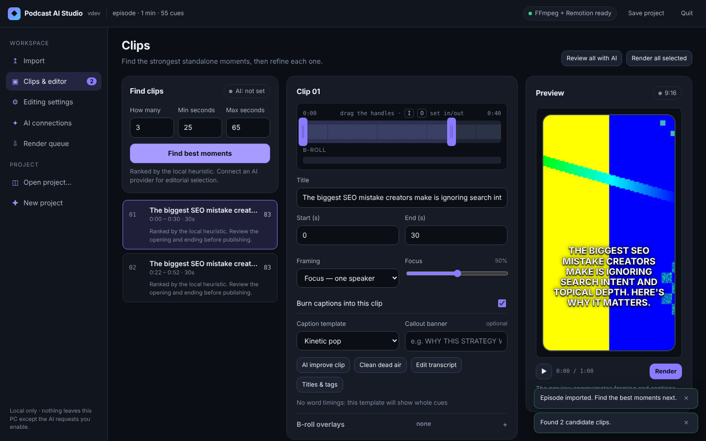

# Podcast AI Studio

Turn a long podcast recording into captioned, vertical short-form clips on Windows — with real word-level caption timing, editorial clip selection by ChatGPT or Claude, and a Remotion-powered renderer.

[](https://github.com/boormajor/AI-clipping-editor/actions/workflows/ci.yml)
[](https://github.com/boormajor/AI-clipping-editor/releases)
[](LICENSE)

- **Import** an MP4/MOV/MKV. Audio is transcribed through Groq or OpenAI Whisper with measured word timestamps (or bring your own timed SRT/VTT).
- **Find clips** with the local heuristic or let ChatGPT / Claude pick standalone moments and title them.
- **Edit** each clip: trim on a timeline, choose framing (single speaker, split, AI shot plan), pick from 15 caption templates, add B-roll from local files or free Pexels footage, clean dead air, generate titles and tags.
- **Render** 9:16, 4:5, 1:1 or 16:9 MP4s with Remotion. FFmpeg takes over automatically if Remotion is unavailable.
- **Local by design.** A localhost-only server, a per-launch session token, and nothing uploaded except the audio or transcript excerpts you send to the AI services you choose.



## Requirements

| | |
|---|---|
| OS | Windows 10 21H2 or later, 64-bit (macOS/Linux work from source; the native file picker is Windows-only) |
| Runtime | FFmpeg and Node.js 18+ — the installer fetches both with `winget` |
| Hardware | 8 GB RAM; an NVIDIA GPU speeds up the FFmpeg fallback only |
| Accounts | A speech API key (Groq free tier or OpenAI) for transcription; optionally ChatGPT Plus/Pro, Claude Pro/Max, or an OpenAI/Anthropic API key for editorial AI |

## Install

1. Download `PodcastAIStudio-<version>-windows-x64.zip` from the [latest release](https://github.com/boormajor/AI-clipping-editor/releases/latest) and verify it against `SHA256SUMS.txt` if you like.
2. Extract the **entire** ZIP to a folder you own (for example `C:\Apps\PodcastAIStudio`), not `Program Files`.
3. Double-click **`Install-and-Run.bat`**. The first run installs FFmpeg, Node.js and the Remotion dependencies (a few minutes); later runs start in seconds. Keep the console window open while you work — it prints the address to open if the app window does not appear.

> **Windows SmartScreen** may warn that the executable is unrecognised because the build is not code-signed yet. Choose *More info → Run anyway* after verifying the checksum.

## Workflow

1. **Import.** Choose the video. Leave *Transcript* empty and paste a Groq or OpenAI speech key for word-accurate captions, or point at a timed SRT/VTT. Import runs in the background with progress and can be cancelled.
2. **Find clips.** Set how many clips and the length range. With the heuristic you get ranked passages; with an AI provider connected you get titled, context-checked moments.
3. **Edit.** Drag the in/out handles (or press <kbd>I</kbd>/<kbd>O</kbd> at the playhead), set framing and focus, pick a caption template, add overlays. Edits save automatically.
4. **Render.** Renders run one at a time in the queue. Finished files land in your export folder (`PodcastAI-Exports` beside the video unless you chose another).
5. **Save the project** (<kbd>Ctrl</kbd>+<kbd>S</kbd>) to keep the transcript, clips and settings as a `.project.json` you can reopen later.

### Keyboard shortcuts (Clips page)

| Key | Action |
|---|---|
| <kbd>Space</kbd> / <kbd>K</kbd> | Play / pause the preview |
| <kbd>J</kbd> / <kbd>L</kbd> | Skip back / forward 5 s |
| <kbd>←</kbd> / <kbd>→</kbd> | Nudge 0.1 s (<kbd>Shift</kbd> for 1 s) |
| <kbd>I</kbd> / <kbd>O</kbd> | Set clip start / end at the playhead |
| <kbd>↑</kbd> / <kbd>↓</kbd> in the clip list | Select the previous / next clip |
| <kbd>Ctrl</kbd>+<kbd>S</kbd> | Save the project file |

## Captions

Transcription returns a measured start and end time for every word, so word-by-word templates (karaoke wipe, pop, box highlight, typewriter…) follow the speech exactly. The app never interpolates or invents word timings: when only a cue-level SRT is available, those templates show whole cues with the group animation instead.

*Editing settings* controls the font, size, colours, how many words appear at once (1–12), the vertical position, keyword emphasis and a sync offset. Fonts are fetched from Google Fonts at render time; if the machine is offline the renderer retries with Arial.

## AI providers

| Provider | What it needs | Used for |
|---|---|---|
| Local heuristic | Nothing | Ranking passages by hook phrases and length |
| ChatGPT Plus / Pro | Sign in with ChatGPT (OpenAI's documented app authorisation; the session is stored encrypted with Windows DPAPI) | Clip selection, editorial review, titles & tags |
| Claude Pro / Max | The official [Claude Code](https://code.claude.com/docs/en/setup) CLI, signed in with your subscription | Same |
| OpenAI / Anthropic API | A pay-as-you-go API key (kept in memory for the session) | Same |

Editorial AI only ever receives transcript text. Cloud transcription receives compressed audio excerpts. Nothing else leaves your PC.

## Where data lives

| Item | Location |
|---|---|
| Rendered clips, project files, downloaded stock footage | Your export folder (default `PodcastAI-Exports` beside the video) |
| Last project, job history, transcription cache, logs | `%APPDATA%\PodcastAIStudio` (`studio.log`, `logs\<job>.log`) |
| ChatGPT session | `%APPDATA%\PodcastAIStudio\chatgpt-profile.dat` (DPAPI-encrypted) — delete it or click *Disconnect* to sign out |
| Setup log | `%LOCALAPPDATA%\PodcastAIStudio\setup.log` |

Uninstall by deleting the extracted folder and `%APPDATA%\PodcastAIStudio`.

## Troubleshooting

| Symptom | What to do |
|---|---|
| "winget is not available" during setup | Install FFmpeg and Node.js manually (links are printed), then run `Install-and-Run.bat` again |
| The app window does not open | Open the `http://127.0.0.1:…/session?token=…` address printed in the console in Edge or Chrome |
| "This tab is not linked to the running app" | The tab was opened without the session link; use the printed address |
| Renders say **FFmpeg** in the queue | Remotion failed (details in *Show log*). Usually Node or `npm ci` is missing — rerun setup. The FFmpeg fallback burns cue-level captions without word animation |
| Transcription fails with HTTP 401/403 | The speech key is wrong or for the other provider. ChatGPT/Claude subscriptions are not speech keys |
| Transcription is slow | Episodes are split into ~8-minute parts uploaded two at a time; results are cached, so re-importing is instant |
| Port already in use | Start with `PodcastAIStudio.exe -port 0` (the default) or any free port |

Logs for every job are kept under `%APPDATA%\PodcastAIStudio\logs`.

## Command-line options

```
PodcastAIStudio.exe [-port N] [-no-browser] [-state-dir PATH] [-remotion PATH] [-log-level debug] [-version]
```

`-no-token` disables the session token and is intended only for local development.

## Developing

```bash
go test -race ./...                       # backend
cd remotion && npm ci && npm run typecheck && npm run smoke   # renderer
node scripts/check-ui-ids.mjs             # front end
go run ./cmd/studio -remotion ./remotion -no-token   # run locally
```

See [CONTRIBUTING.md](CONTRIBUTING.md) for the full developer guide, [docs/ARCHITECTURE.md](docs/ARCHITECTURE.md) for how the pieces fit together and [docs/API.md](docs/API.md) for the local HTTP API. Releases are produced by the `Release` workflow when a `v*` tag is pushed.

## Licensing

Podcast AI Studio is MIT licensed. It depends on [Remotion](https://remotion.dev), which is free for individuals and small teams but requires a company licence above that threshold, and on FFmpeg, which you install separately. See [NOTICE.md](NOTICE.md).
